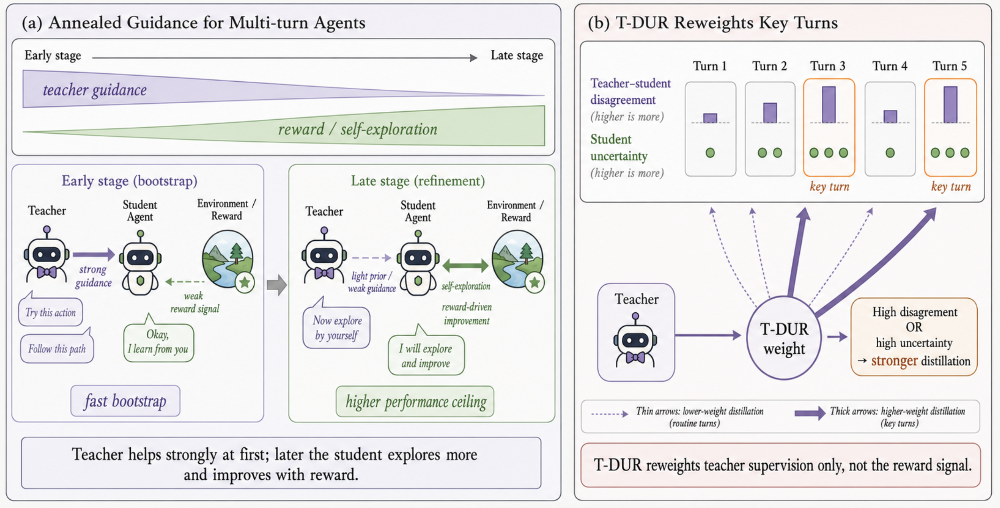
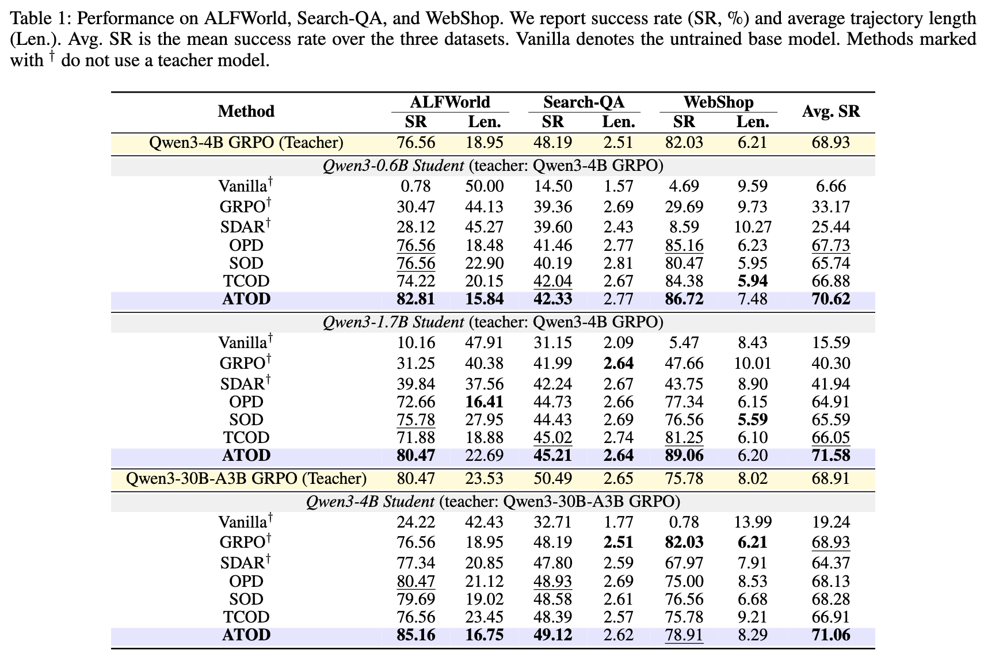

<h1 align="center">
ATOD: Annealed Turn-Aware On-Policy Distillation for Multi-Turn Agentic Tasks
</h1>
<div align='center' style="font-size:18px;">
<p>
    <a href="https://arxiv.org/abs/2606.27814">
      
    </a>
  </p>
</div>


## 🔥 Overview

We introduce **ATOD** (**A**nnealed **T**urn-aware **O**n-policy **D**istillation), a hybrid online distillation algorithm that combines OPD and GRPO with a smoothly annealed schedule and turn-level disagreement-uncertainty reweighting (T-DUR) for training small language-model agents on long-horizon, multi-turn tasks.
<div align="center" style="display:flex; justify-content:center; gap:20px; align-items:flex-start;">
  
</div>

## 📖 Results
ATOD achieves substantial improvements over OPD, SOD, TCOD, SDAR, and GRPO baselines on ALFWorld, WebShop, and Search-QA across all student scales, and even surpasses the corresponding teacher models.
<div align="center">
  
</div>

## 🤗 Model Checkpoints

All six GRPO-trained **teacher** checkpoints used by ATOD are released in a single Hugging Face repo: [**TanQT24/ATOD_ckpt**](https://huggingface.co/TanQT24/ATOD_ckpt). Each subfolder is a standard `transformers` / vLLM-loadable model directory (`actor_hf/`).

| Environment | Teacher | Subfolder in the repo |
|---|---|---|
| ALFWorld | Qwen3-4B (GRPO) | `alfworld_grpo_qwen3_4b/actor_hf` |
| ALFWorld | Qwen3-30B-A3B (GRPO) | `alfworld_grpo_qwen3_30ba3b/actor_hf` |
| WebShop | Qwen3-4B (GRPO) | `webshop_grpo_qwen3_4b/actor_hf` |
| WebShop | Qwen3-30B-A3B (GRPO) | `webshop_grpo_qwen3_30ba3b/actor_hf` |
| Search-QA | Qwen3-4B (GRPO) | `search_grpo_qwen3_4b/actor_hf` |
| Search-QA | Qwen3-30B-A3B (GRPO) | `search_grpo_qwen3_30ba3b/actor_hf` |

### Download

Download a single teacher (recommended — the 30B-A3B checkpoints are large):

```bash
pip install -U "huggingface_hub[cli]"

# e.g. the ALFWorld Qwen3-4B teacher
hf download TanQT24/ATOD_ckpt \
  --include "alfworld_grpo_qwen3_4b/*" \
  --local-dir ~/ckpts/ATOD_ckpt
```

Or download the whole repo:

```bash
hf download TanQT24/ATOD_ckpt --local-dir ~/ckpts/ATOD_ckpt
```

Python API:

```python
from huggingface_hub import snapshot_download

path = snapshot_download(
    repo_id="TanQT24/ATOD_ckpt",
    allow_patterns=["search_grpo_qwen3_4b/*"],
    local_dir="~/ckpts/ATOD_ckpt",
)
```

### Use in training scripts

Point `teacher_model_path` in `examples/atod_trainer/*.sh` at the downloaded `actor_hf` directory, e.g.

```bash
# examples/atod_trainer/run_alfworld_atod_qwen3_1.7b.sh
student_model_path=Qwen/Qwen3-1.7B
teacher_model_path=~/ckpts/ATOD_ckpt/alfworld_grpo_qwen3_4b/actor_hf
```

With these released teachers you can skip **Step 1 (teacher GRPO training)** below and run ATOD distillation directly.

## 🛠️ Installation

For the two-GPU **ALFWorld vanilla OPD** experiment (Qwen3-8B GRPO teacher,
Qwen3-1.7B student, 512 tokens/turn, 150 updates), see
[setup, launch, checkpoint resume and metrics-only W&B instructions](docs/vanilla_opd_alfworld.md).


### Python environment

```bash
conda create -n atod python==3.12 -y
conda activate atod

pip3 install vllm==0.11.0

pip3 install flash-attn==2.7.4.post1 --no-build-isolation --no-cache-dir
pip install -e .
```

Log in to Weights & Biases if you use WandB logging (scripts pass `trainer.logger=['console','wandb']` in many cases):

```bash
export WANDB_API_KEY=your_key_here
```

### Install Supported Environments

#### 1. ALFWorld
Install with pip:
```bash
pip3 install gymnasium==0.29.1
pip3 install stable-baselines3==2.6.0
pip3 install alfworld
```

Download PDDL & Game files and pre-trained MaskRCNN detector (will be stored in `~/.cache/alfworld/`):
```bash
alfworld-download -f
```

#### 2. WebShop
WebShop requires Python <=3.10, so begin by creating a new environment:
```bash
conda create -n verl-webshop python==3.10 -y
conda activate verl-webshop
```

Install WebShop:
```bash
cd ./agent_system/environments/env_package/webshop/webshop
./setup.sh -d all
```

After WebShop is installed, return to the root directory and install the verl package:
```bash
cd repo_root/
pip3 install torch==2.6.0 --index-url https://download.pytorch.org/whl/cu124
pip3 install flash-attn==2.7.4.post1 --no-build-isolation
pip3 install -e .
pip3 install vllm==0.8.2
# spacy 3.7.2 requires typer<0.10.0,>=0.3.0, but you have typer 0.15.2 which is incompatible.
# weasel 0.3.4 requires typer<0.10.0,>=0.3.0, but you have typer 0.15.2 which is incompatible.
```
The warnings can be safely ignored.

#### 3. Search
```bash
cd ./agent_system/environments/env_package/search/third_party
pip install -e .
pip install gym==0.26.2
```

Prepare dataset (data will be saved at `~/data/searchR1_processed_direct`):
```bash
cd repo_root/
python examples/data_preprocess/preprocess_search_r1_dataset.py
```


Since faiss-gpu is not available via pip, we setup a separate conda environment for the local retrieval server. Running this server will use around 6GB of GPU memory per GPU, so make sure to account for this in your training run configuration. Build Retriever environments:
```bash
# Create and activate the retriever environment with Python 3.10
conda create -n retriever python=3.10 -y
conda activate retriever

# Install PyTorch (with GPU support) and related libraries
conda install numpy==1.26.4 # needed to stop incompatible version of numpy from being installed via pip
pip install torch==2.6.0 torchvision==0.21.0 torchaudio==2.6.0 --index-url https://download.pytorch.org/whl/cu124

# Install other Python packages
pip install transformers datasets pyserini huggingface_hub

# Install the GPU version of faiss
conda install faiss-gpu==1.8.0 -c pytorch -c nvidia -y

# Install the API service framework
pip install uvicorn fastapi
```

Download the index:
```bash
conda activate retriever

local_dir=~/data/searchR1
python examples/search/searchr1_download.py --local_dir $local_dir
cat $local_dir/part_* > $local_dir/e5_Flat.index
gzip -d $local_dir/wiki-18.jsonl.gz
```

Start the local flat e5 retrieval server: 
```bash
conda activate retriever

# redirect the output to a file to avoid cluttering the terminal
# we have observed outputting to the terminal causing spikes in server response times
bash examples/search/retriever/retrieval_launch.sh > retrieval_server.log 
```


### Training

**Step 1. Train the teacher (GRPO).** Scripts live under `examples/grpo_teacher_trainer/` ({alfworld, search, webshop} × {4B, 30B-A3B}) and assume the repo root as working directory. Edit the model path in the script to point to your local checkpoint.

```bash
# Teacher training — {alfworld, search, webshop} × {4b, 30ba3b}
bash examples/grpo_teacher_trainer/run_alfworld_grpo_qwen3_4b.sh
bash examples/grpo_teacher_trainer/run_search_grpo_qwen3_30ba3b.sh
bash examples/grpo_teacher_trainer/run_webshop_grpo_qwen3_4b.sh
```

**Step 2. Train the student with ATOD.** Scripts live under `examples/atod_trainer/`. Each script sets the student model, the GRPO-trained teacher (point `teacher_model_path` to the teacher trained in Step 1), the annealing schedule (`κ`, `ρ`, `T`), and the T-DUR parameters.

```bash
# ATOD (ours) — {alfworld, search, webshop} × {0.6b, 1.7b, 4b}
bash examples/atod_trainer/run_alfworld_atod_qwen3_1.7b.sh
bash examples/atod_trainer/run_search_atod_qwen3_1.7b.sh
bash examples/atod_trainer/run_webshop_atod_qwen3_1.7b.sh
```

## ⭐️ Citation

If you find this project useful, welcome to cite us.

```bibtex
@misc{atod2026,
      title={ATOD: Annealed Turn-Aware On-Policy Distillation for Multi-Turn Agentic Tasks}, 
      year={2026},
      eprint={2606.27814},
      archivePrefix={arXiv},
      primaryClass={cs.LG},
      url={https://arxiv.org/abs/2606.27814}, 
}
```

## 🤝 Acknowledgement

This project builds on [SDAR](https://github.com/ZJU-REAL/SDAR), [verl-agent](https://github.com/langfengQ/verl-agent), [veRL](https://github.com/volcengine/verl), [ALFWorld](https://github.com/alfworld/alfworld), [SkillRL](https://github.com/aiming-lab/SkillRL), and [Search-R1](https://github.com/PeterGriffinJin/Search-R1). We thank the authors of those projects.
